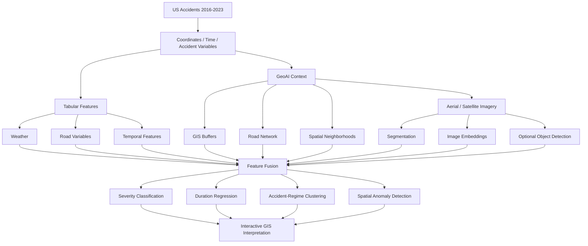

# GeoCrashAI

> The original research engine described below is retained for noncommercial research. The new independent FARS/AADT safety engine, agency screening workspace, tests and deployment instructions are documented in [README.md](README.md) and [docs/SAFETY_ENGINE.md](docs/SAFETY_ENGINE.md).

## Multimodal Geospatial Machine Learning for Traffic Accident Severity, Duration, Risk Regimes, and Spatial Anomaly Detection

GeoCrashAI is a research-oriented machine learning and GeoAI framework for studying traffic accidents as **spatial events embedded in a road, environmental, temporal, and built-environment context**, rather than as isolated rows in a tabular dataset.

The project begins with the **US Accidents (2016–2023)** dataset as the primary labeled accident source and progressively enriches each accident with geospatial context derived from its coordinates. The central idea is to compare conventional accident/weather models against models that incorporate road-network structure, surrounding land use, aerial or satellite imagery, learned geospatial embeddings, and spatial-neighborhood information.

The intended study design is:

> **National tabular baseline → city-scale GeoAI deep dive → multimodal modeling → spatial anomaly discovery → interactive GIS interpretation**

This structure keeps the project computationally manageable while preserving a strong research question: **does explicit geospatial context improve our ability to characterize and predict traffic-accident outcomes?**

---

## Quick Start

```bash
./run.sh                          # tests -> ingest -> GIS/imagery -> models -> discovery
.venv/bin/python -m src.engine    # national ML engine for the website
.venv/bin/python -m src.benchmark # model leaderboard (all metrics)
.venv/bin/python -m src.analysis  # EDA + model diagnostic plots
.venv/bin/python -m web.server    # explorer at http://localhost:8878
```

- **Data**: Kaggle *US Accidents (2016–2023)*, `US_Accidents_March23.csv` (7,728,394 rows), streamed from a byte-identical Hugging Face mirror (the Kaggle API needs credentials). Set `GEOCRASH_CSV=/path/to/csv` to use a local Kaggle download. Kept: a 10% national sample plus every row for Omaha metro, Lincoln, Chicago and Dallas.
- **Study area**: Omaha–Council Bluffs metro + Lincoln (26,480 accidents at 8,745 unique locations).
- **GIS**: OpenStreetMap via OSMnx: road/intersection density, building/parking/green/water/land-use fractions at 100/250/500 m, nearest-road class/speed/lanes, distance to highway.
- **Imagery**: NAIP (Microsoft Planetary Computer, 0.6 m RGB+NIR): NDVI land-cover fractions + ResNet-18 embeddings (stand-in for OpenGeoAI models).
- **Website** (`web/`): search any US place (Google Places; key in `.env` as `GOOGLE_MAPS_API_KEY`) → one report: density percentile vs all US crash cells, hour × weekday heatmaps (observed and model-expected severe), ranked ~110 m spots by observed-vs-expected severity with satellite thumbnails, model partial-dependence (weather × light, visibility, temperature, road features), outliers (unexpectedly severe, longest impact, Isolation Forest), duration distribution + quantile predictions, 12-month forecast with a local backtest against seasonal naive. Map: Google roadmap / satellite / live traffic + animated replay. Code: `web/server.py` (API), `web/report.py` (analytics), `web/static/` (UI).

### National engine results (temporal holdout: train on earliest 80%, test on latest 20%)

| Model | Result |
|---|---|
| Severity classifier (HGB) | AUC severe-vs-not 0.682 (spatial-block OOF AUC 0.782) |
| Duration regressor (HGB) | MAE 60.5 min vs 69.5 min median baseline |
| Monthly forecaster (0.25° grid, 3,183 cells) | MAE 21.5 vs seasonal-naive 27.1, last-value 23.5 |
| Accident regimes (KMeans, silhouette) | k = 8: rain, clear midday, cloudy midday, night, signalized crossing, stop-sign, fog dawn, snow |

National tabular baselines (10% sample, 4-class severity): gradient boosting balanced accuracy 0.551, random forest 0.459, logistic 0.400. Metro ablation A–E tables are in `outputs/tables/metro_ablation.csv`.

---

## Table of Contents

- [Project Motivation](#project-motivation)
- [Research Questions](#research-questions)
- [Project Objectives](#project-objectives)
- [Study Scope](#study-scope)
- [Data Sources](#data-sources)
- [Unit of Analysis](#unit-of-analysis)
- [Feature Design](#feature-design)
- [System Architecture](#system-architecture)
- [Machine-Learning Tasks](#machine-learning-tasks)
- [Modeling Strategy](#modeling-strategy)
- [GeoAI and Imagery Components](#geoai-and-imagery-components)
- [Spatial Analysis](#spatial-analysis)
- [Evaluation Framework](#evaluation-framework)
- [Expected Outputs](#expected-outputs)
- [Suggested Repository Structure](#suggested-repository-structure)
- [Implementation Workflow](#implementation-workflow)
- [Reproducibility](#reproducibility)
- [Limitations and Interpretation](#limitations-and-interpretation)
- [Project Roadmap](#project-roadmap)
- [Status](#status)

---

## Project Motivation

Conventional traffic-accident machine-learning projects often treat an accident as a tabular observation containing variables such as severity, timestamp, weather, visibility, temperature, road attributes, and nearby infrastructure. That representation is useful, but incomplete: every accident also occurs inside a **physical spatial environment**.

A crash location may differ from another location in ways that are not fully represented by the original accident table, including:

- road density;
- intersection density;
- surrounding building density;
- parking concentration;
- vegetation and open-space coverage;
- nearby commercial or residential development;
- road-network geometry;
- visually observable roadway context;
- historical accident behavior in the surrounding neighborhood.

GeoCrashAI therefore treats each accident as a multimodal observation:

```text
Accident record
+ geographic location
+ weather
+ time
+ road context
+ surrounding built environment
+ imagery-derived representation
+ local historical accident behavior
```

The project is designed to determine whether these additional spatial signals provide measurable predictive or descriptive value beyond conventional accident variables.

---

## Research Questions

The project is organized around five primary research questions rather than around a list of algorithms.

### RQ1 — Accident Severity Classification

**Can geospatial and environmental context improve accident-severity classification beyond conventional accident and weather variables?**

### RQ2 — Accident Impact Duration Regression

**Can spatial context improve prediction of how long an accident disrupts traffic?**

### RQ3 — Unsupervised Accident-Regime Discovery

**Can GIS features and aerial imagery reveal meaningful latent road-environment or accident regimes without predefined labels?**

### RQ4 — Spatial Anomaly Detection

**Can the system identify locations whose accident outcomes are unexpectedly severe relative to geographically or environmentally similar locations?**

### RQ5 — Multimodal Learning

**Does combining conventional accident data with GeoAI-derived imagery features outperform either modality used independently?**

These questions create a single research narrative connecting supervised learning, unsupervised learning, spatial analysis, computer vision, and GIS.

---

## Project Objectives

GeoCrashAI has six practical objectives:

1. Build strong tabular baselines using the original accident, temporal, weather, and road variables.
2. Generate GIS-derived contextual features around accident coordinates at multiple spatial scales.
3. Incorporate aerial or satellite imagery through segmentation and/or learned image embeddings.
4. Compare tabular, geospatial, imagery-only, and multimodal representations.
5. Discover crash regimes, hotspots, and outcome anomalies using unsupervised and spatial methods.
6. Present model outputs geographically through an interpretable GIS-based interface or map.

---

## Study Scope

### National Baseline

The complete US Accidents dataset can be used for broad descriptive analyses and conventional machine-learning baselines.

### City-Scale GeoAI Deep Dive

Processing imagery for every accident in a multi-million-record national dataset would shift the project toward large-scale data engineering. The proposed design therefore uses a focused metropolitan region for computationally expensive GeoAI experiments.

Candidate study areas described in the project plan include:

- Lincoln + Omaha;
- Chicago;
- Dallas;
- Los Angeles;
- another metro with sufficient accident density and imagery coverage.

A city-scale subset on the order of **tens of thousands of accidents** is appropriate for the deep multimodal experiment, subject to final data availability and compute limits.

### Study Design Summary

```text
National dataset
    │
    ├── Descriptive analysis
    ├── Tabular classification baseline
    └── Tabular regression baseline

Selected metropolitan region
    │
    ├── GIS feature extraction
    ├── Spatial neighborhoods
    ├── Aerial/satellite imagery
    ├── Segmentation / embeddings
    ├── Multimodal modeling
    ├── Clustering
    ├── Hotspot analysis
    └── Spatial anomaly detection
```

---

## Data Sources

### 1. US Accidents (2016–2023)

The project plan uses the Kaggle **US Accidents (2016–2023)** dataset as the primary labeled data source. The source document describes approximately **7.7 million georeferenced accident records** covering the period from 2016 through early 2023.

Relevant fields include:

- latitude and longitude;
- accident severity;
- accident start time;
- accident end time;
- temperature;
- weather condition;
- visibility;
- wind-related variables;
- road-related indicators;
- junction/intersection indicators;
- traffic-signal indicators;
- nearby infrastructure variables.

The severity field is represented on a **1–4 scale** in the source project plan.

The start and end timestamps also allow construction of a continuous target:

```text
Accident Impact Duration = End Time - Start Time
```

This provides two immediate supervised-learning targets:

- **Classification:** accident severity;
- **Regression:** accident impact duration.

### 2. Geospatial Context

Each accident coordinate can be associated with one or more local spatial buffers, for example:

- 100 m;
- 250 m;
- 500 m.

Within each buffer, the project can derive measures describing the local road and built environment.

### 3. Aerial / Satellite Imagery

For the city-scale experiment, a small image patch can be associated with each accident location. The project plan proposes using OpenGeoAI-oriented workflows for imagery acquisition, preprocessing, segmentation, embedding extraction, and related GeoAI processing.

---

## Unit of Analysis

The fundamental unit is an individual accident event enriched with local spatial context.

Conceptually, a record changes from:

```text
Severity = 3
Temperature = 25 F
Visibility = 2 mi
Rain = Yes
Time = 17:35
```

into a richer representation such as:

```text
Severity = 3
Temperature = 25 F
Visibility = 2 mi
Rain = Yes
Time = 17:35
Rush Hour = Yes
Road Density = ...
Intersection Density = ...
Building Fraction = ...
Vegetation Fraction = ...
Parking Fraction = ...
Image Embedding = [...]
Neighborhood Accident Statistics = ...
```

The exact feature definitions and normalization procedure should be documented during implementation.

---

## Feature Design

### A. Original Tabular Features

Potential baseline variables include:

- weather;
- time of day;
- date-derived variables;
- visibility;
- temperature;
- road type or road-related indicators;
- intersection/junction indicators;
- traffic-signal indicators;
- severity, where appropriate as an explanatory variable for non-severity targets.

### B. Temporal Features

Derived temporal variables may include:

- hour of day;
- day of week;
- month;
- weekend indicator;
- rush-hour indicator;
- nighttime indicator.

### C. GIS-Derived Features

Candidate spatial-context features include:

- road density;
- intersection density;
- building density;
- parking density;
- impervious-surface fraction;
- vegetation fraction;
- water presence;
- nearby commercial development;
- residential density;
- open-space fraction.

These can be calculated at multiple buffer sizes to determine whether local versus broader neighborhood context matters.

### D. Imagery-Derived Features

Two complementary approaches are proposed.

#### Semantic / Instance Segmentation

Aerial images around each accident can be segmented into categories such as:

- road;
- building;
- vegetation;
- parking;
- water;
- other.

The segmentation output can be converted into quantitative features such as:

```text
Road Fraction       = Road Pixels / Total Pixels
Building Fraction   = Building Pixels / Total Pixels
Vegetation Fraction = Vegetation Pixels / Total Pixels
```

This allows computer-vision outputs to feed directly into conventional machine-learning models.

#### Learned Image Embeddings

Instead of explicitly measuring every visible structure, each image can be transformed into a learned feature vector:

```text
Image_i -> [e1, e2, ..., ed]
```

The embedding can then be:

- used directly by a model;
- reduced using PCA;
- visualized or clustered after dimensionality reduction;
- fused with tabular and GIS features.

### E. Object-Level Context

Object detection can optionally be used to estimate contextual variables such as:

- visible cars;
- parking spaces;
- intersection complexity;
- other detectable infrastructure.

This component is optional and does not require training an object detector from scratch if an appropriate pretrained workflow is available.

### F. Neighborhood-Aware Features

For each accident, spatial statistics can be calculated using nearby historical accidents, for example within a 1 km neighborhood:

- number of nearby accidents;
- mean severity;
- severe-accident rate;
- mean accident duration;
- nighttime-accident fraction.

These features enable a direct comparison between:

```text
Conventional ML: X_i -> y_i
```

and:

```text
Spatial ML: (X_i, Neighborhood_i) -> y_i
```

Care must be taken during implementation to compute historical-neighborhood features without leaking information from validation or test outcomes.

---

## System Architecture



---

## Machine-Learning Tasks

### Task 1 — Severity Classification

**Target:** accident severity.

The experiment should compare progressively richer representations.

#### Model Group A — Conventional Accident Variables

Input:

```text
weather + time + road variables + visibility + temperature + related tabular features
```

Candidate model families from the source plan include:

- Random Forest;
- XGBoost;
- SVM.

#### Model Group B — Tabular + GIS Context

Add features such as:

- road density;
- intersection density;
- land-cover variables;
- built-environment measurements.

#### Model Group C — Imagery Features

Use image embeddings or other imagery-derived features to predict accident severity.

#### Model Group D — Multimodal Model

Fuse:

```text
Tabular + GIS + Image Features -> Severity
```

The most important comparison is not simply which classifier has the highest score. It is whether adding spatial and visual context produces a consistent improvement over the conventional baseline.

---

### Task 2 — Accident Impact Duration Regression

**Target:**

```text
Duration = End Time - Start Time
```

Potential inputs include:

- severity;
- weather;
- time;
- road characteristics;
- spatial context;
- built environment;
- image embeddings.

Candidate model families in the project plan include:

- Linear Regression / Ridge;
- Random Forest;
- Gradient Boosting;
- XGBoost;
- neural-network regression.

The research emphasis is whether urban form and road-network characteristics help explain the duration of traffic disruption.

---

### Task 3 — Accident-Regime Clustering

For this task, severity is not used as a predefined class label. Instead, the system clusters accidents using combinations of:

```text
Tabular Features + GIS Features + Image Embeddings
```

Candidate algorithms include:

- K-Means;
- Gaussian Mixture Models;
- DBSCAN;
- HDBSCAN;
- hierarchical clustering.

Possible discovered regimes might correspond to patterns such as:

- dense urban intersections during rush hour;
- highway corridors with poor visibility;
- suburban commercial roads surrounded by parking areas;
- rural roads with nighttime accidents and lower road density.

These labels should be assigned **after** examining cluster characteristics. The purpose is to discover natural structure rather than impose predefined accident categories.

---

### Task 4 — Spatial Hotspot Discovery

A second clustering analysis can operate specifically on geographic coordinates using DBSCAN or HDBSCAN.

The analysis should distinguish between:

- locations with many accidents;
- locations with many severe accidents;
- locations with unexpectedly severe outcomes relative to their total accident frequency.

This is more informative than mapping accident counts alone.

---

### Task 5 — Spatial Outcome Anomaly Detection

The anomaly problem is framed as:

> Which geographic areas have accident outcomes that are unexpectedly poor given their environmental and spatial context?

Two locations may appear similar in terms of:

- road geometry;
- weather;
- surrounding development;
- imagery embedding;
- traffic-related context;

but have very different observed severity patterns.

A location whose outcome is substantially worse than comparable locations can be flagged for additional investigation.

This is an **anomaly-identification task**, not a causal claim. Potential explanations such as signage, lighting, speed, intersection geometry, or unmeasured traffic conditions should be treated as hypotheses requiring independent evidence.

---

### Task 6 — Imagery-Regime Discovery

The imagery can also be analyzed independently of accident outcomes.

Workflow:

```text
Aerial Image
    -> Geospatial/Image Embedding
    -> Dimensionality Reduction
    -> Clustering
    -> Road-Environment Regimes
    -> Overlay Accident Outcomes
```

Potential clusters may correspond to:

- dense downtown intersections;
- suburban arterial roads;
- interstate/highway environments;
- rural two-lane roads;
- commercial parking corridors.

Accident outcomes can then be overlaid on these learned environment classes to examine whether visually similar roadway environments exhibit similar risk patterns.

---

### Task 7 — Graph-Based Road-Network Extension

As an advanced extension, the road system can be represented as a graph:

```text
G = (V, E)
```

where:

- `V` = intersections;
- `E` = road segments.

Accident statistics can be attached to road segments, such as:

```text
Edge 174
- Accidents: 38
- Mean Severity: 2.7
- Rain Accidents: 9
- Night Accidents: 14
```

This enables comparison of standard tabular approaches with graph-aware models. A graph neural network is a stretch goal rather than a requirement for the core project.

---

### Task 8 — Spatiotemporal Forecasting Extension

Because the source dataset spans multiple years, the project can also aggregate accidents by spatial grid and time interval.

For a grid cell `(x, y)` at time `t`:

```text
N_accidents(x, y, t) -> N_accidents(x, y, t + 1)
```

An example task is predicting the following week's accident count for each 1 km grid cell.

Candidate baselines include:

- historical average;
- Random Forest;
- XGBoost;
- LSTM or another temporal model.

This is an optional extension and should not distract from the five core research questions.

---

## Modeling Strategy

A clean experiment should measure the incremental value of each information source.

| Experiment | Tabular | GIS Context | Imagery | Neighborhood | Purpose |
|---|---:|---:|---:|---:|---|
| Baseline A | ✓ |  |  |  | Conventional accident model |
| Baseline B | ✓ | ✓ |  |  | Value of explicit GIS context |
| Baseline C |  |  | ✓ |  | Predictive value of imagery alone |
| Model D | ✓ | ✓ | ✓ |  | Core multimodal comparison |
| Model E | ✓ | ✓ | ✓ | ✓ | Spatially contextualized multimodal model |

The key result is the **difference between representations**, not merely the ranking of algorithms within one representation.

---

## GeoAI and Imagery Components

The source project plan uses OpenGeoAI as the geospatial feature engine for tasks such as:

- geospatial preprocessing;
- imagery acquisition workflows;
- image-chip generation;
- remote-sensing analysis;
- semantic or instance segmentation;
- object detection;
- image/geospatial embedding extraction;
- road-network processing and simplification.

The exact OpenGeoAI modules and external imagery sources should be pinned in the implementation documentation once the codebase is finalized.

---

## Spatial Analysis

### Multi-Scale Buffers

Spatial context should be measured at more than one radius where feasible:

```text
100 m -> immediate roadway context
250 m -> local intersection / block context
500 m -> broader neighborhood context
```

The project can then test whether the predictive signal is strongest at the immediate crash location or at a broader neighborhood scale.

### Hotspots vs. Dangerous Locations

Raw crash frequency and crash severity should be analyzed separately.

A location may be:

- frequent but dominated by low-severity accidents;
- infrequent but unusually severe;
- frequent and severe;
- neither frequent nor severe.

This distinction is essential for interpretable GIS results.

### Spatial Similarity

The project can compare locations using combinations of:

- engineered GIS features;
- imagery embeddings;
- road-network characteristics;
- historical accident statistics.

This provides the foundation for both clustering and anomaly detection.

---

## Evaluation Framework

> **Note:** The source project defines the experimental questions and model families but does not prescribe a complete metric protocol. The following metric set is a recommended implementation layer and should be finalized before experiments begin.

### Classification

Recommended reporting:

- accuracy;
- balanced accuracy;
- macro F1;
- per-class precision and recall;
- confusion matrix.

Because severity levels may be imbalanced, macro-averaged and class-specific metrics are more informative than accuracy alone.

### Regression

Recommended reporting:

- MAE;
- RMSE;
- R²;
- residual analysis;
- error distribution by severity, geography, and road-environment regime.

### Clustering

Recommended evaluation and interpretation:

- silhouette score where appropriate;
- cluster-size distribution;
- stability under different random seeds or parameter settings;
- feature profiles for every cluster;
- geographic coherence;
- outcome distributions after clustering.

### Anomaly Detection

Evaluation should emphasize:

- reproducibility of flagged locations;
- sensitivity to neighborhood definition;
- comparison against matched or similar locations;
- visual inspection on the map;
- avoidance of causal language without additional evidence.

### Multimodal Ablation

The most important ablation is:

```text
Tabular only
vs.
Tabular + GIS
vs.
Imagery only
vs.
Tabular + GIS + Imagery
vs.
Tabular + GIS + Imagery + Neighborhood Context
```

This directly tests the primary scientific contribution.

---

## Expected Outputs

A complete GeoCrashAI study should produce:

1. **National exploratory analysis** of accident patterns.
2. **Severity-classification baselines** using original tabular features.
3. **Impact-duration regression baselines**.
4. **City-scale GIS feature dataset** at one or more spatial buffer sizes.
5. **Imagery dataset or image-chip index** for the selected region.
6. **Segmentation-derived spatial features** and/or learned image embeddings.
7. **Multimodal model comparison**.
8. **Accident-regime clusters** with interpretable profiles.
9. **Spatial hotspot analysis**.
10. **Spatial outcome-anomaly map**.
11. **Optional imagery-environment clusters**.
12. **Optional graph and temporal extensions**.
13. **Interactive GIS visualization** integrating model predictions and spatial results.
14. **Research report or paper** organized around the five research questions.

---

## Suggested Repository Structure

The exact code organization can change during implementation, but a professional repository could follow this structure:

```text
GeoCrashAI/
├── README.md
├── LICENSE
├── requirements.txt
├── environment.yml
├── configs/
│   ├── data.yaml
│   ├── spatial.yaml
│   ├── models.yaml
│   └── experiments.yaml
│
├── data/
│   ├── raw/
│   ├── interim/
│   ├── processed/
│   ├── imagery/
│   └── geo/
│
├── notebooks/
│   ├── 01_data_exploration.ipynb
│   ├── 02_tabular_baselines.ipynb
│   ├── 03_gis_features.ipynb
│   ├── 04_imagery_features.ipynb
│   ├── 05_multimodal_models.ipynb
│   ├── 06_clustering.ipynb
│   └── 07_spatial_anomalies.ipynb
│
├── src/
│   ├── data/
│   │   ├── load_accidents.py
│   │   ├── clean_accidents.py
│   │   └── split_data.py
│   │
│   ├── features/
│   │   ├── temporal.py
│   │   ├── gis_buffers.py
│   │   ├── neighborhood.py
│   │   ├── segmentation.py
│   │   └── embeddings.py
│   │
│   ├── models/
│   │   ├── classification.py
│   │   ├── regression.py
│   │   ├── clustering.py
│   │   ├── anomaly.py
│   │   └── multimodal.py
│   │
│   ├── spatial/
│   │   ├── hotspots.py
│   │   ├── road_graph.py
│   │   └── mapping.py
│   │
│   ├── evaluation/
│   │   ├── metrics.py
│   │   ├── ablation.py
│   │   └── diagnostics.py
│   │
│   └── visualization/
│       ├── plots.py
│       └── maps.py
│
├── outputs/
│   ├── figures/
│   ├── maps/
│   ├── tables/
│   ├── models/
│   └── reports/
│
└── tests/
```

Large raw datasets and imagery should normally remain outside version control and be referenced through documented download/preparation steps.

---

## Implementation Workflow

### Phase 1 — Data Preparation

1. Load the US Accidents dataset.
2. Validate coordinates and timestamps.
3. Remove or flag unusable records.
4. Derive accident-impact duration.
5. Create temporal variables.
6. Define national and city-scale subsets.

### Phase 2 — Tabular Baselines

1. Train severity-classification baselines.
2. Train duration-regression baselines.
3. Record a reproducible benchmark before introducing GeoAI features.

### Phase 3 — Spatial Feature Engineering

1. Create spatial buffers around accident coordinates.
2. Generate road-, intersection-, land-cover-, and built-environment features.
3. Construct neighborhood-level accident statistics using leakage-safe procedures.
4. Compare spatial scales.

### Phase 4 — Imagery Pipeline

1. Associate imagery with accident coordinates.
2. Generate consistent image chips.
3. Extract segmentation features and/or learned embeddings.
4. Store image identifiers and derived features separately from raw image files.

### Phase 5 — Multimodal Modeling

Train and compare:

```text
Tabular
Tabular + GIS
Imagery
Tabular + GIS + Imagery
Tabular + GIS + Imagery + Neighborhood
```

### Phase 6 — Unsupervised and Spatial Discovery

1. Cluster accident representations.
2. Cluster geographic coordinates for hotspot discovery.
3. Cluster image embeddings for road-environment discovery.
4. Compare outcomes across learned clusters.
5. Detect spatial outcome anomalies.

### Phase 7 — Interpretation and Mapping

Create GIS views for:

- accident density;
- severity patterns;
- predicted severity;
- duration predictions;
- cluster membership;
- hotspot membership;
- anomaly scores;
- selected image/environment regimes.

---

## Reproducibility

A final implementation should record at least:

- dataset version;
- geographic study boundaries;
- preprocessing rules;
- train/validation/test split logic;
- random seeds;
- coordinate reference systems;
- buffer radii;
- imagery source and acquisition date where available;
- image-chip size/resolution;
- segmentation or embedding model version;
- hyperparameters;
- package versions;
- model evaluation outputs.

Spatial projects require particular attention to train/test design because nearby locations can be highly correlated. The final experimental protocol should document whether splits are random, temporal, geographic, or grouped by spatial region.

---

## Limitations and Interpretation

Several limitations should be explicit in the final report.

### Association Is Not Causation

A feature associated with severe accidents does not necessarily cause those accidents. The anomaly-analysis component is intended to identify locations for further investigation, not to establish causal explanations.

### Spatial Dependence

Nearby observations may share road, weather, infrastructure, and neighborhood characteristics. Naive random splitting can therefore produce overly optimistic estimates if spatial dependence is ignored.

### Imagery Time Mismatch

Aerial or satellite imagery may not have been captured at the same time as an accident. Features derived from imagery should therefore be interpreted as environmental context unless temporal alignment is established.

### Dataset Coverage and Reporting Bias

The accident dataset represents recorded events and may not capture all incidents uniformly across locations or time periods.

### Compute and Storage

National-scale image acquisition and processing can become substantially more expensive than tabular modeling. This is why the project separates national baseline analysis from city-scale GeoAI processing.

---

## Project Roadmap

### Core Project

- [ ] Prepare US Accidents dataset
- [ ] Build national descriptive analysis
- [ ] Train severity-classification baseline
- [ ] Train impact-duration regression baseline
- [ ] Select metropolitan study area
- [ ] Build GIS buffer features
- [ ] Extract city-scale imagery
- [ ] Generate segmentation features and/or embeddings
- [ ] Train multimodal models
- [ ] Run clustering analysis
- [ ] Run hotspot analysis
- [ ] Run spatial anomaly analysis
- [ ] Build GIS visualization
- [ ] Complete multimodal ablation study
- [ ] Write results around RQ1–RQ5

### Stretch Goals

- [ ] Object-detection-derived context
- [ ] Image-environment clustering
- [ ] Road-network graph modeling
- [ ] Graph neural network comparison
- [ ] Grid-based accident forecasting
- [ ] Temporal sequence modeling

---

## Status

**Current stage:** implemented. Data pipeline, national engine and web explorer run end to end; the metro multimodal ablation and discovery outputs land in `outputs/`.

The project concept, research questions, major feature families, machine-learning tasks, and overall experimental architecture are defined. Dataset preparation, final study-region selection, implementation details, model tuning, and empirical results should be documented as the codebase is developed.

---

## Working Project Title

**GeoCrashAI: Multimodal Geospatial Machine Learning for Traffic Accident Severity, Duration, Risk Regimes, and Spatial Anomaly Detection**

---

## Citation

If this repository becomes part of a paper, course project, thesis, or public software release, add the final citation here.

```bibtex
@misc{geocrashai,
  title  = {GeoCrashAI: Multimodal Geospatial Machine Learning for Traffic Accident Severity, Duration, Risk Regimes, and Spatial Anomaly Detection},
  author = {Author(s) to be added},
  year   = {2026}
}
```

---

## License

Add the repository's final software/data license here. Dataset and imagery sources may have separate licenses or terms of use and should be documented independently.
