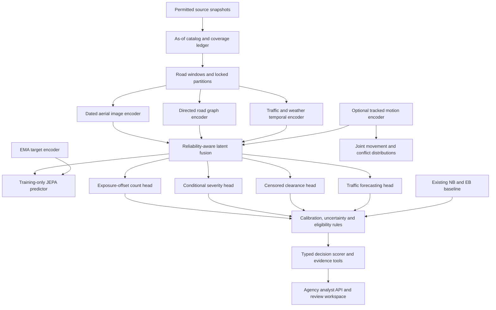

# GeoCrash road safety foundation model architecture

Status: design proposal, not implemented or trained. The layer counts, parameter ranges, data volumes, losses, and gates below are engineering hypotheses. Nothing here demonstrates a new scientific result or a trained foundation model. The useful claim to pursue is transferable representations across jurisdictions and tasks, not simply a large checkpoint.


The proposed working name is **GeoCrash RoadWorld**. It is a domain foundation-model research program: learn reusable road representations, then adapt them to traffic forecasting, network screening, incident severity, clearance and optional motion tasks. The existing FARS/NDOT engine remains the operational baseline. The scratch design below has no trained weights yet.

**Deliverables in this design:** the learning architecture, data contract, typed decision layer, four research hypotheses, training and compute plan, evaluation gates, production layout and implementation sequence. [The proposed configuration](../configs/foundation/roadworld_scratch.json) is machine-readable design material, not an executable trainer. [The current Omaha evidence](OMAHA_STUDY.md) remains a separate measured study.



### Existing versus proposed

| Capability | Current repository | This architecture |
|---|---|---|
| Official-source screening | FARS/NDOT panel, exposure proxy, NB/EB and development mixture | Strong baseline and fallback; prospective outcome definitions remain explicit |
| Research models | Trees, residual MLP, dense expert model and corrected Omaha experiments | Benchmarks only; original noncommercial artifacts do not seed the commercial scratch lineage |
| Multimodal foundation pretraining | Not implemented | New randomly initialized encoders, JEPA trainer and multi-region corpus |
| Live individual movement | No measured trajectories | Optional branch disabled until permitted tracks and suitable evaluation exist |
| Typed decision model | No OpenJEV integration | New domain scorer; isolated OpenJEV research comparison is optional |
| Deployment | Private Google Cloud API, GCS, BigQuery and scheduled jobs | Extend those services with model registry, batched embeddings and controlled GPU training |


## 1. Distinguish the three concepts

- OpenJEV is the linked choice-scoring VLM, not JEPA. Per the verified model card, its existing weights are noncommercial and Qwen-derived. Keep its outputs/checkpoints out of the commercial training lineage unless separate permission is obtained. Its typed choices and calibrated readout can inspire a separately implemented interface; a typed interface does not itself produce valid calibrated risk estimates.
- JEPA is a learning pattern: predict target representations from partially observed context. I-JEPA predicts masked image representations; V-JEPA 2 extends latent predictive learning to video and separately learns action-conditioned robotics dynamics. Neither paper establishes that this works for crash risk. [I-JEPA](https://arxiv.org/abs/2301.08243), [V-JEPA 2](https://arxiv.org/abs/2506.09985).
- The proposed model below is initialized randomly and learns from a rights-cleared road corpus. Loading a pretrained vision backbone is a useful comparator, but that run must be called transfer learning, not training the entire foundation model from scratch.

## 2. Two time scales and an immutable prediction origin

The main model learns road-segment conditions across time scales. The first crash-incidence product uses annual or agency-supported coarse horizons; hourly traffic forecasting is a separate head. Hourly crash-risk claims require sufficiently dense, mature all-crash labels and independent validation. An optional actor module forecasts observable movement over seconds. Aerial imagery is infrastructure context, not a measurement of current driver behavior.

Every example has an origin `t0`, geographic fold, source lineage, acquisition time, publication/availability time, and target horizon. Observed input must satisfy both event/acquisition time <= t0 and available_at <= t0. An archived forecast is the explicit exception: its issue/availability time must precede t0, while its forecast-valid time may be in the target horizon. A historical prediction cannot receive modern imagery, corrected future maps, realized future weather, future incident duration, or crashes reported after its origin. Weather forecasts use archived issue times. As-of availability applies to pretraining too in a strict historical evaluation; otherwise explicitly label the evaluation transductive or retrospective.

Training units are complete road windows, including zero-crash windows. A crash-case table alone cannot identify unconditional crash incidence. Annual AADT supports coarse annual exposure and cannot be treated as observed hourly traffic. Use a separate coarse annual mode until actual historical detector/probe volumes exist.

## 3. Tensor contract for the first model

One batch item is a central corridor and its bounded connected neighborhood. Defaults below are limits, not assumptions that each source exists everywhere. `B` is batch size, `N<=128` directed graph links, `U<=N` unique exposure/label units, hidden dimension `d=384`, and each modality carries a valid mask, age, quality, resolution, and observation status.

| Input | Tensor / representation | Role |
|---|---|---|
| Road network | Node/segment values `[B,N,32]`; geometry samples `[B,N,20,2]`; sparse directed turn edges and edge attributes | Length, curvature, grade where known, lanes, speed limit, intersection type, legal connectivity; local metric coordinates, not identity embeddings for each road |
| Imagery | Up to four corridor tiles, two available acquisitions each: `[B,4,2,4,256,256]` | RGB+NIR when licensed/available; RGB-only uses an explicit missing-band mask. Acquisition date and ground sampling distance accompany each tile. Tiles cover portions of the corridor, not necessarily all 128 segments |
| Dynamic history | `[B,N,24,16]` plus masks | Last 24 hourly observations: measured volume/speed/occupancy and issued weather/operational fields. Missing traffic remains missing; calendar and AADT are not substitutes for a detector history |
| Issued forecast context | Optional `[B,N,H,8]` plus issue/valid-time masks | Archived weather or operational forecasts available at the origin; a small MLP adds these to horizon queries, outside the pooled fusion-context token budget |
| Exposure | Positive `E[B,U,H]`, observation status, uncertainty | Vehicle-miles for each unique count unit and horizon, measured for retrospective training or forecast with uncertainty for operational prediction |
| Optional actors | `[B,A<=64,Tpast=20,10]` at 10 Hz | Two-second tracks: local position, velocity, heading, size, type, tracking uncertainty and visibility. Identity is only a transient track key |
| Optional control history | Timestamped signals, closures, work zones | Observed control states; hypothetical interventions use a separate scenario path |

Trajectory labels require actual tracking or licensed trajectory data. FARS distraction/alcohol fields are outcome-conditioned reports and cannot supervise general driver intent or population propensity. Keep aggregate FARS behavior summaries as descriptive evidence until appropriate prospective movement labels exist.

`H` is task-specific: the initial count head has one annual query; the traffic head has four queries at 1, 3, 6 and 24 hours. **Initial annual screening masks the hourly dynamic and short-range forecast branches.** It uses available static road context, dated imagery and separately declared annual exposure. A later annual-context adapter can encode genuine historical monthly/seasonal observations, with a new documented tensor contract. A single 24-hour history or short-range weather forecast is not treated as a representative year. Annual and hourly batches carry explicit task/mode IDs; their masks and allowed features differ.

Directed graph links and exposure units are not interchangeable. When counts/AADT describe both directions of a physical road, pool its directed-link states into one unit before the count head and apply its exposure once. Directional predictions require genuinely directional counts and matching labels. Store the graph-to-target-unit mapping; never copy a two-way AADT or the same crash into two directional targets. The count readout is `[B,U,H]`, while graph and traffic states may remain directional.

## 4. Coherent dense backbone before optional experts

All trainable encoders below are randomly initialized for the scratch experiment. Standard transformer blocks use six attention heads, width 384, and MLP expansion 4. Approximate parameter range: 45–60 million including the training predictor and small heads; exact count must be generated from the implementation. EMA copies increase training memory, not the deployed model's independent parameter count.

1. **Image encoder:** shared eight-block patch-16 transformer. Each 256x256 tile yields 256 patch tokens. Two dates are processed with temporal and sensor metadata, then learned spatial queries pool each acquisition to 16 tokens. Eight acquisitions yield at most 128 image tokens. Keep coordinates relating tile patches to segments for cross-attention; unavailable imagery never becomes fabricated pixels. SatMAE provides precedent for explicit temporal/spectral treatment, rather than pretending these are ordinary RGB photos. [SatMAE](https://arxiv.org/abs/2207.08051).
2. **Road encoder:** geometry point MLP/pooling plus attribute embedding, then four graph-attention blocks. Attention biases encode legal connectivity, shortest-path distance and relative bearing. Directed turn structure is retained; duplicated centerlines must not double physical exposure. Output `[B,N,384]`.
3. **Dynamic encoder:** four temporal blocks shared across roads, with causal attention and elapsed-time/missingness encodings. Produce current and horizon-query segment states without quadratic attention over all `N*24` inputs. Explicit hourly aggregation is performed before tokenization; it is not inferred from arbitrary ordering.
4. **Fusion:** 64 learned latent queries attend to available modality tokens in six latent self/cross-attention blocks. Segment query tokens retrieve fused states `[B,N,384]`, using segment-local geometry references. Reliability features modulate attention/gates but cannot remove observations silently. Modality dropout trains graceful degradation; late fusion and simple concatenation are required baselines.
5. **Training-only predictor:** four blocks map visible fused context plus masked segment/time/modality query positions to latent targets. It is removed from ordinary downstream inference unless latent forecasting is requested.
6. **Optional actor encoder:** four temporal/interaction blocks, with lane cross-attention and relative actor geometry. It produces actor states and a scene summary. A six-mode joint scene decoder predicts eight seconds at 10 Hz, i.e. means `[B,6,A,80,2]`, positive scales and six scene-level mixture probabilities. Shared scene modes preserve interactions better than multiplying unrelated marginal agent forecasts. This is an initial hypothesis, not a claim of capturing all multimodal interaction. Attention-based motion forecasting has precedent in Wayformer. [Wayformer](https://arxiv.org/abs/2207.05844).

**Bounded token accounting:** images have at most `4 tiles * 2 dates * 256 patches = 2,048` raw patch tokens per example, processed in eight shared-weight 256-token sequences, not one full quadratic sequence and not 2,048 tokens per road. Road and temporal branches contribute at most 128 pooled tokens each; imagery contributes 128, so the base fusion cross-attention sees at most 384 context tokens and 64 latent queries. Temporal attention is factorized into 128 sequences of length 24. Preserve each image tile's actual metric footprint/ground sampling distance: roads outside its footprint receive no invented image features. If larger graph neighborhoods are required, retain the same image budget and report partial coverage or sample another window; do not silently multiply image crops by N. A precise implementation should log these caps and the number of covered segments.

**Parameter bookkeeping:** an ordinary width-384 transformer block with 4x MLP has roughly 1.77M weights. The 8 image, 4 road and 4 temporal blocks contribute roughly 28.3M; six fusion blocks with extra cross-attention roughly 14.2M; four predictor blocks roughly 7.1M; embeddings/readouts add a few million. This gives a planning estimate around 50–55M trainable weights and around 43–48M inference weights after removing the predictor. The optional motion branch adds approximately 8–12M. The EMA target duplicates encoder/fusion weights during training only; optimizer state and activations require separate memory accounting. Count actual parameters after implementation before publishing a model size.

**Caching rule:** raw immutable imagery, calibrated features and patch reads may be cached. Learned image embeddings must be recomputed while the image encoder is training from scratch. Cache learned embeddings only once the responsible encoder is frozen, and key them by encoder checkpoint, source hash, sensor calibration and acquisition time. Otherwise training silently becomes inconsistent with the current encoder.

**All-missing behavior:** each attention module retains a learned no-observation sentinel or takes an explicit bypass path when every real key is masked. Never apply softmax to an all-negative-infinity row. Preserve missingness and coverage flags after fusion. A sentinel prevents numerical failure; it does not authorize a risk estimate without required exposure or evidence. The API's eligibility/abstention check remains authoritative.

Actor inference can run at an intersection edge device; hourly summaries enter the main model only when legal, validated and sufficiently covered. Without actors the deployed model remains the road backbone. Do not put a 27B chat model on every segment or label LLM conversation among agents as physical human-behavior analysis.

**Optional later MoE:** only after the dense control is competitive, replace the last two fusion MLPs with four experts and top-two routing. Router inputs include representations and modality reliability; experts are not prespecified as invented psychological personalities. Add load balancing and capacity diagnostics. Compare equal training FLOPs, equal active parameter counts, rare-road-type performance and missing-modality behavior. A mixture may reduce performance on scarce subgroups; dense remains the default until evidence favors routing.

## 5. Self-supervised objectives, with failure controls

Let `f_theta` be the online encoder and `f_xi` its EMA target copy. Predictor `p_phi` sees only permitted context and target position/horizon queries:

`L_JEPA = mean_valid Huber(p_phi(f_theta(x_context), q_target), stopgrad(LN(f_xi(x_target_context))))`.

Update `xi <- m*xi+(1-m)*theta`, with an initial proposed cosine schedule `m=.996 -> 1.0`. The teacher may observe the target during training, but it never feeds target values into the student. Within-origin masked targets and future-state targets are separate sampler types. No crash outcome fields are included in encoder pretraining inputs. Multi-step future prediction must not accidentally attend to future dynamic observations.

Mask contiguous connected road subgraphs, consecutive time windows, whole modalities, and contiguous image blocks. Begin with 40–60% masked tokens and 20% whole-modality dropout as tuning ranges, not established optimal settings. Avoid independently masking neighboring image pixels so that road geometry reconstruction becomes trivial interpolation. Retain enough observable context to make the target identifiable; ambiguous future dynamics need probabilistic heads rather than deterministic confidence.

**Mask before encoding:** remove masked student values before image attention, temporal attention, graph message passing, pooling and aggregate-feature construction. Masking only an already pooled token leaks information through neighboring representations. Recompute derived features from visible inputs and invalidate caches whose support includes hidden targets. Explicitly permitted positions/topology may remain visible; hidden measurements and future states may not. Cross-modal reconstruction deliberately retains permitted other modalities, while forecast targets cannot be reconstructed from future observations in any modality. Teacher targets are keyed by exact segment/tile/time IDs and extracted independently of student masks. Test this by perturbing a hidden target: the student input/context must remain unchanged, while the teacher target may change.

Prevent and monitor collapse using stop-gradient, EMA asymmetry, informative masking, target normalization, plus an explicitly ablated variance/covariance regularizer on online sample-level representations. For batch embedding matrix `Z`, use `mean_j max(0,gamma-sqrt(var(Z_j)+eps))` and off-diagonal covariance penalty. Compute on diverse sites/time windows, not thousands of correlated tokens from one road. The regularizer is an adaptation inspired by VICReg; EMA alone is not a proof against collapse. Track per-dimension standard deviations, covariance effective rank, nearest-neighbor diversity, and frozen-probe transfer. [VICReg](https://arxiv.org/abs/2105.04906).

Gradient accumulation does not enlarge this statistical batch. Under the proposed two-device, four-window microbatch, a differentiable cross-device gather supplies at most eight simultaneous embeddings, even though the optimization batch is 128. Use variance diagnostics on that live batch; disable the covariance loss in the initial small-memory configuration unless at least 32 distinct corridors are simultaneously gathered. This threshold is an experiment setting, not a theoretical guarantee. Evaluate rank and covariance separately on at least 1,024 diverse detached probe embeddings collected across inference batches. Do not advertise accumulated gradients as a large-batch covariance estimate.

Auxiliary self-supervised losses: masked known physical attributes (cross entropy or Huber), future speed/flow likelihood when measured, and map/imagery alignment with positive pairs co-located and contemporaneous. If contrastive negatives are used, exclude adjacent/duplicate roads and overlapping image footprints. Begin with `L_ssl=L_JEPA+lambda_var*L_var+lambda_cov*L_cov+lambda_attr*L_attr+lambda_dyn*L_dyn`; choose coefficients using validation gradient scales and fixed downstream probes. Do not write arbitrary weights into marketing as a discovery. Image reconstruction is an ablation, not an unconditional requirement.

## 6. Heads correspond to separate decisions

**Crash frequency:** `Y_s,h ~ NB(mu_s,h,k_h)`, `log(mu)=log(E)+b_h+u_jurisdiction+g_h(z)`, `k=softplus(k_raw)+eps`; variance `mu+mu^2/k`. Exposure is a vehicle-mile offset, not a feature the model is free to ignore. A regularized jurisdiction term allows partial pooling; zero history means the prior, not arbitrary fitted ID embeddings. For annual periods `E=AADT*length_miles*days`; hourly measured flow gives `E=sum(volume_hour*length_miles)`. Unknown exposure means no valid per-mile score. At prediction, integrate volume-forecast uncertainty rather than inserting the subsequently observed traffic. Fatal counts require FARS-compatible targets; injury counts require appropriately licensed state injury records. Zero-inflation is an ablation only if held-out likelihood supports it.

**Severity given an incident:** a calibrated categorical head with the actual agency injury ontology, or ordered link if the ontology supports ordering. It estimates `P(severity | incident, context)`, not incidence. Label crosswalks and changes in reporting policy are versioned. Never claim that an Omaha source-specific four-class code equals injury severity in all states.

**Clearance time:** discrete-time hazards `h_k=P(T in bin k | T>=bin k,x_at_report)`. For observed clearance in bin k, log likelihood is `log(h_k)+sum_{j<k}log(1-h_j)`; for censoring after completed bin c, it is `sum_{j<=c}log(1-h_j)`. Use the actual feed's event definition; incident end, road reopening and administrative record closure are different endpoints. Predict quantiles and survival curves, report censoring-aware evaluation, and keep observed-at-report severity separate from retrospective actual severity.

**Movement/conflict:** joint mixture NLL on observed future trajectories with masks, plus audited lane/off-road consistency terms. Derive time-to-collision and post-encroachment estimates with uncertainty. These are surrogate conflict measures, not calibrated probabilities of a fatal crash. Evaluate interaction collision rate, multimodal NLL, minADE/minFDE and scenario-stratified calibration; minimum-distance metrics alone reward extra guesses.

**Interventions:** keep verified CMF applicability and benefit-cost computation as an evidence layer outside the unrestricted neural predictor. A changed signal timing token does not identify the causal effect of installing that signal. Learn intervention response only with appropriate longitudinal interventions and a separate causal evaluation design; label simulations accordingly.

## 7. Three falsifiable system-level research hypotheses

These are proposed contributions to investigate, not claims that no prior paper has explored them.

| Hypothesis | Test and ablations | Failure / decision |
|---|---|---|
| **Availability-aware graph JEPA transfers under stale and missing observations.** Predict connected road/time latent blocks while encoding actual age, modality and publication delay. | Hold out entire jurisdictions and future intervals; compare supervised scratch, image-only masked learning, graph-only masked learning, multimodal JEPA without age, and full model. Corrupt/drop inputs using realistic acquisition delays; compare count deviance, frozen-probe performance and uncertainty coverage. | Reject if transfer gains vanish on strict as-of data or if missing-modality performance is worse than tabular/graph baselines. The architecture must not receive future imagery to win. |
| **Exposure-factorized representation learning separates traffic opportunity from per-mile hazard.** Shared representation predicts demand dynamics and a separate crash-rate residual, with mandatory exposure offset. | Compare count regression without offset, offset NB, supervised dense model, pretrained offset model and shuffled exposure controls. Use held-out demand shifts and jurisdictions; evaluate likelihood, calibration by volume decile and screening yield at fixed road mileage. | Reject if it just ranks high-volume roads, depends on noisy denominator artifacts, or fails against a calibrated NB/SPF baseline. This factorization does not by itself prove causal disentanglement. |
| **Reliability-gated motion summaries improve network safety forecasting only where observed.** Aggregate validated movement distributions/conflicts into time-local road summaries, then transfer through a missingness-aware gate. | Compare no motion, simple aggregate speed/braking, full movement encoder, shuffled motion, ungated transfer, and artificial sensor dropout. Hold out intersections and recording systems. Compare prospective conflict calibration and, only with enough true events, crash forecast skill. | Reject if improvements disappear when equal sensor coverage and location leakage are controlled, or if camera coverage creates spurious neighborhood rankings. No inference of personal psychology or unsupported driver traits. |

All comparisons need locked outer geographic/time tests, inner tuning, confidence intervals clustered by corridor/site and time, and explicit multiplicity handling. A previously inspected Omaha holdout is development evidence; reserve a new external prospective set before making capability claims.

## 8. Training sequence and what would earn “foundation model”

1. **Data readiness first:** rights-cleared multi-region images/maps/dynamics, mature labels, acquisition vintages, zero-event road windows, unique road IDs across map versions, and leakage tests. Current 26k Omaha crashes and Nebraska annual records alone do not support all tensors above.
2. **Small correctness model:** same interfaces at width 192, fewer layers, and a bounded corpus; verify masks, counts, causality, missing modalities, numerical stability and reproducible checkpoints before spending at scale.
3. **Dense scratch pretraining:** proposed 45–60M architecture; batch diverse independent corridors, train mixed-precision with bounded attention and checkpointing. Record examples, road-km, independent sites, acquisition dates and exposure-hours, not merely duplicated token counts.
4. **Frozen probes before joint fine-tuning:** incident occurrence, masked road attributes, speed/flow, clearance, and—only if present—motion tasks. Compare random initialization, strong task-specific models and licensed pretrained alternatives with the same training budget.
5. **Separate domain adaptation:** supervised heads, calibrated predictions on held-out agency data, prospective shadow evaluation and error analysis. Lock a fallback statistical model.
6. **Scale conditionally:** widen to 768 and more layers only after size/data curves show gain per unit compute. Mixtures, multi-billion parameter backbones, generated synthetic driving and generative language interfaces are optional research branches, not prerequisites.

A foundation-model claim would require a broad pretraining corpus, measurable adaptation to several downstream tasks, strong transfer to jurisdictions not used in supervised training, accessible artifact/provenance/model card, and reproducible evaluation. Until then call it a proposed road-safety representation model. No parameter count or architectural acronym guarantees acquisition interest.

## 9. OpenJEV reference and the new typed decision layer

The linked [OpenJEV model card](https://huggingface.co/openjev/openjev) describes a tuned decision model that reads candidate-token scores at its first output position, rather than generating a prose answer. Its reported browser/text benchmarks do not measure road safety. The proposed product borrows the **typed decision contract**, not those benchmark claims or weights.

Source inspection on 2026-09-29 pinned revision `0b6bb6e571bc7bcd6f1eb68de706f592f29c6483`. The [Hub metadata](https://huggingface.co/api/models/openjev/openjev) reports 27,356,728,560 BF16 parameters. Its [NOTICE](https://huggingface.co/openjev/openjev/raw/0b6bb6e571bc7bcd6f1eb68de706f592f29c6483/NOTICE) names Qwen3.8-27B as its base, while [config.json](https://huggingface.co/openjev/openjev/raw/0b6bb6e571bc7bcd6f1eb68de706f592f29c6483/config.json) uses the Qwen3_5 architecture class. Record that naming difference; do not identify the exact base from the implementation class alone. The NOTICE places weights under CC BY-NC 4.0 and helper/serving files under Apache 2.0. Commercial permission is not present in this workspace.

For the proposed commercial lineage, implement a small domain decision scorer trained on permitted agency examples. Given fused evidence `z`, task ID `q`, and candidate features `c_k`, score each candidate with a shared MLP:

`s_k = MLP([z, task_embedding(q), candidate_encoder(c_k), coverage, uncertainty])`.

`p_k = softmax(mask_eligible(s)_k / T_q)`; learn `T_q` on held-out calibration data. For yes/no tasks fit a separately validated logistic calibration. These are probabilities over supplied alternatives, **not automatically calibrated event risks**. Risk comes from the statistical heads and their own calibration.

The initial scorer uses structured candidate schemas and a fixed task vocabulary. Sharing the scorer across candidates makes its calculation independent of list position. Train with permuted candidates and test order invariance, adding irrelevant candidates, option omission and adversarial descriptions. New arbitrary natural-language tasks are out of scope until a separately evaluated text encoder exists. A later text encoder may be trained from scratch on a permitted technical corpus; loading a pretrained language model changes that component's provenance and experiment name.

Train the scorer using expert-reviewed correct choices, pairwise rankings and explicit abstentions. Preserve reviewer disagreement as soft targets where justified. Do not use the current small crash table to fabricate decision supervision. A proposed loss is choice cross-entropy plus a validation-tuned consistency penalty between candidate permutations; constraint checks remain deterministic.

| Typed task | Permitted output | Source of truth |
|---|---|---|
| Evidence completeness | adequate / request traffic count / inspect geometry / defer | Coverage ledger and reviewed agency cases |
| Review routing | traffic engineer / data steward / incident operations | Versioned agency workflow |
| Candidate treatment eligibility | eligible / ineligible / insufficient evidence | Deterministic CMF applicability checks; the model cannot override them |
| Rank eligible scenarios | Ordered candidates with numerical assumptions | Verified benefit-cost calculations and analyst preferences |
| Report consistency | supported / unsupported / review | Referenced facts and calculations, with human audit |

Add a separate selective-prediction gate using missing exposure, out-of-distribution diagnostics, ensemble disagreement and observed calibration failure. An empty eligible set returns `insufficient_evidence`; it does not force a softmax choice. Log candidate set, model version, evidence IDs, calibration version and abstention reason. Free-form narrative generation is an optional reporting service and cannot alter numerical predictions.

**Fourth research hypothesis:** use the model to select the next useful measurement. Candidate actions might be a traffic count, a geometry audit or a site visit. Estimate expected reduction in forecast uncertainty per collection cost, then compare against random sampling, traffic-volume sampling and a simple uncertainty ranking on independently audited sites. The endpoint is measured error reduction per survey effort, not model confidence alone. Begin with expert-assisted active learning; learned action value needs records of measurements actually collected and their outcomes.

## 10. Data architecture and rights lineage

Create three independently identified manifests: `commercial_candidate`, `research_only`, and `evaluation_only`. A checkpoint inherits all source, label, teacher, tokenizer and synthetic-generation dependencies. An unconfirmed permission status fails the commercial-candidate build. This is an engineering release rule; a reviewer still determines the applicable rights and terms for a particular release.

| Source family | Intended use | Required checks and missing work |
|---|---|---|
| FARS | Fatal-crash labels and descriptive factors | Case inclusion is fatal crashes, not all accidents; official publication/version and maturity must be recorded. [NHTSA FARS](https://www.nhtsa.gov/research-data/fatality-analysis-reporting-system-fars) |
| State/city all-crash records | Injury ontology, incidence and incident endpoints | Obtain permitted records, reporting coverage and crosswalks; reconcile duplicates with FARS instead of counting both |
| Agency road inventories | Historical geometry, lane/turn/control attributes | Effective dates, edit dates, projection, ownership and redistribution terms |
| OSM history where used | Permitted contextual graph | Preserve attribution and assess database distribution obligations under ODbL; public access does not waive terms. [OSM copyright](https://www.openstreetmap.org/copyright) |
| NAIP or other aerial assets | Static and slowly changing road context | Verify individual asset metadata, acquisition dates, actual resolution, source rights and bands. Do not infer that every mixed basemap layer has one license. [USGS imagery/source qualifications](https://www.usgs.gov/faqs/are-usgs-topographic-maps-copyrighted?items_per_page=6&page=0&qt-news_science_products=0) |
| Traffic detectors or permitted probes | Measured flow, speed, occupancy and exposure | Sensor uptime, count expansion, missingness, seasonal factors and rights; AADT and hourly observations are distinct. [FHWA traffic methods](https://www.fhwa.dot.gov/policyinformation/tmguide/tmg_2022/traffic-data-methodologies.cfm) |
| Weather and alerts | Observed history and archived forecasts | Issue time, valid time, ingestion time and measured latency; future observed weather is never an operational input |
| Agency video/trajectory agreements | Observable movement and conflict labels | Rights for training and deployment, privacy, camera calibration, tracking quality, site coverage and retention |
| Intervention records | Before/after evaluation | Installation dates, treatment selection, comparison sites, exposure and concurrent changes |

Do not scrape proprietary Maps/Street View imagery as a training shortcut. Do not silently place noncommercial driving datasets or model-generated labels into the commercial candidate corpus. For example, the [Waymo Open Dataset terms](https://waymo.com/open/terms/) specify noncommercial use and restrictions on production use of derived models; it belongs in a separately permitted research path, not an assumed commercial bootstrap. The existing Kaggle-derived weights and OpenJEV weights stay outside the scratch commercial lineage by default.

The current local inventory—153,273 national fatal crashes, 11,048 Nebraska road segments, a 44,192 segment-year panel, and 26,480 noncommercial metro incidents—supports baselines and engineering tests. It does **not** supply the multi-region dynamic histories, prospective all-crash coverage, trajectories or longitudinal intervention evidence required by this design. AADT 2025 proxies and post-incident imagery cannot be relabeled as historically available observations.

### Versioned records and samples

Each observation records `event_or_acquisition_time`, `available_at`, `ingested_at`, spatial reference, geometry version, source hash, quality and allowed uses. Corrections preserve older versions. As-of joins use what could actually have been known at the forecast origin; the latest database row is not necessarily eligible.

Each supervised label has a separate `label_available_at` and `label_definition_version`. Include it only when `label_available_at < training_cutoff`, allowing reporting/clearance lag. For a future-window target, require `origin < target_window_end <= label_available_at < training_cutoff`. A coverage calendar specifies when an agency genuinely reported each outcome type. **No event in a missing feed is an unknown label, not a zero.** Audited zero-crash windows require coverage, valid geometry and eligible exposure.

Self-supervised future-state targets must also have been observed and available by the training cutoff and must belong to permitted training geography. A target hidden from the student is not exempt from the outer partition. Record crash-to-road linkage quality and unmatched records; ambiguous or withheld matches cannot silently make a road's outcome history complete. Evaluate linkage sensitivity and coverage before interpreting estimated per-mile risk.

Proposed sample record, with illustrative identifiers and no real prediction:

```json
{
  "sample_id": "example-corridor-origin",
  "origin_utc": "2024-01-01T00:00:00Z",
  "segment_version_ids": ["example-segment-v3"],
  "partition": "train",
  "input_assets": [{
    "modality": "aerial",
    "acquired_at": "2023-06-01T00:00:00Z",
    "available_at": "2023-10-01T00:00:00Z",
    "asset_sha256": "recorded-by-ingestor",
    "license_record_id": "reviewed-asset-license",
    "commercial_training_allowed": true
  }],
  "coverage": {"fatal_crash_reporting": true, "all_crash_reporting": false},
  "target": {
    "task": "annual_fatal_crash_count",
    "window_end": "2025-01-01T00:00:00Z",
    "label_available_at": "2026-01-01T00:00:00Z",
    "value": null
  }
}
```

The target is read by the loss function, never serialized into model input. Unknown exposure, missing imagery and absent motion remain explicit masked states. Maintain road-segment correspondence across inventory changes; a split/merge must not create duplicate exposure. Keep train/validation/test corridor IDs, image footprints and camera IDs in a separate immutable split registry.

## 11. Corpus stages, optimization and compute

The following sizes are proposed collection targets, not available datasets or empirically established minimums. Count independent geography and observation hours as well as sampled windows, because overlapping windows are not independent examples.

| Stage | Proposed corpus | Purpose and exit |
|---|---|---|
| Correctness | Up to 10,000 audited windows, a tiny randomly initialized model | Exercise leakage masks, unit conversion, targets, restart/reload and missing modalities; no foundation claim |
| Regional pretraining | 100,000–250,000 unique segments, 250,000–1 million dated tile acquisitions, 5–20 million valid segment-hours across several regions | Dense scratch representation learning; compare against random initialization and statistical baselines |
| Transfer study | Expand toward 1 million segments, multiple road types/climates and several years; reserve entire external jurisdictions | Demonstrate adaptation across at least three tasks, with untouched regions and independent collection systems |
| Motion study | Separately permitted tracked scenes from dozens of independent sites, expanded only after tracking audits | Establish observable motion/conflict transfer; cannot replace network incidence labels |

Start the full dense model with AdamW, proposed learning rate `3e-4`, weight decay `0.05`, betas `(0.9,0.95)`, gradient clipping `1.0`, BF16 where supported, and 5% warmup followed by cosine decay. These are initial experiment settings, not optimized results. A proposed two-device launch uses microbatch 4 per device and accumulation 16, giving effective batch 128 windows. Reduce microbatch and adjust accumulation after a real peak-memory profile. Use checkpointing, stable normalization, finite-loss checks and resumable optimizer/EMA/RNG/sampler state.

The stage sampler alternates static masked-context batches, dynamic future-state batches and paired batches. Each loss averages over **valid observed targets**, and missing objectives contribute no gradient. Normalize task contributions to prevent abundant no-event or camera-rich urban samples from dominating. Do not rebalance occurrence counts by dropping zeros without correcting the sampling likelihood. Prioritize diverse corridors in the representation regularizer rather than treating correlated nearby tokens as independent.

Checkpoint every fixed number of examples and retain manifest, code/config hashes, optimizer state, EMA state, split registry and calibration lineage. Track throughput, GPU utilization, loss scales, representation rank, modality reliance and subgroup probes. Stop for nonfinite gradients, collapsed representations or unresolved leakage before scaling.

### Budget from measurements

Use the simple dense estimate `C ≈ 6 × active_parameters × processed_tokens` only as a rough arithmetic reference. Multimodal branches process different token counts; sparse attention, EMA teacher passes, image decoding and communication make it an inadequate procurement quote. Language-model scaling results such as [Chinchilla](https://arxiv.org/abs/2203.15556) do not establish a universal road-window-to-parameter ratio.

Measure complete-window throughput on the exact architecture over at least 1,000 steady-state steps, with realistic I/O. Then calculate:

`wall_hours = total_window_presentations / measured_global_windows_per_second / 3600`

`GPU_hours = wall_hours × accelerator_count × measured_overhead_factor`

`cost = GPU_hours × quoted_effective_hourly_rate + CPU + storage + I/O + evaluation`.

Illustrative arithmetic only: one million windows presented ten times gives ten million presentations. If a four-accelerator job measures 20–80 windows/second globally, the training loop takes 34.7–138.9 hours, or 138.9–555.6 aggregate GPU-hours. A planning multiplier of two for evaluation, restarts and overhead makes 277.8–1,111.1 GPU-hours. Those throughputs and the multiplier are assumptions to replace with measurements; no hardware price or training success is promised.

For 55M parameters, a conventional mixed-precision Adam budget near 16 bytes/parameter is approximately 0.88 GB for master weights, gradients and optimizer state, plus roughly 0.1–0.2 GB for a teacher copy depending on precision. Activations, attention buffers, inputs and framework allocations can dominate. A 24–80 GB accelerator is a profiling candidate, not a guaranteed fit. Removing the predictor/teacher for inference changes both memory and compute. A 27B scratch model would have roughly 432 GB of optimizer-related state under the same simplified rule before activations; there is no evidence in this project that such scale is justified.

Keep immutable imagery in object storage and stream bounded shards. A 256x256 four-band uint8 crop is 256 KiB before metadata/compression; one million such crops is about 244 GiB. Source orthoimagery, historical versions, dynamic arrays and checkpoints add storage. Do not download that corpus onto the current nearly full laptop. No new accelerator job is launched by this architecture document.

## 12. Evaluation and promotion contracts

Partition before generating overlapping windows, fitting preprocessing, constructing histories or self-supervised pretraining. Reserve connected corridors with a spatial buffer wider than the sampled context footprint; keep overlapping image footprints and all tracks from a camera/site in one partition. Respect graph edges that otherwise connect training context into held-out test roads. Repeat across multiple held-out jurisdictions rather than declaring victory on one city.

For strict inductive transfer, exclude test-region data from pretraining, including unlabeled imagery. A second, separately named transductive adaptation experiment may use it, but cannot claim the same information boundary. Temporal tests require target maturity and archived feature availability. Establish a new prospective final test; the already examined Omaha holdout remains development evidence.

Use separate inner training, model-selection validation, calibration data and locked final evaluation. Register tasks, main metrics, ablations and acceptable subgroup regressions before looking at the final set. Fit conformal/other interval calibration only where its assumptions are defensible; drift breaks exchangeability, so empirical coverage must be monitored and no universal guarantee is claimed.

For a deployment candidate, compare a single model with an ensemble of three independently initialized runs. NB dispersion or survival probabilities describe within-model outcome uncertainty; differences across runs are an imperfect model-uncertainty diagnostic. Integrate a separately estimated exposure distribution where needed. Report predictive intervals and their measured coverage, rather than calling ensemble spread a Bayesian posterior. The initial correctness run uses one model; an ensemble triples relevant training/serving work and must appear in its budget. Fit downstream heads on frozen representations first, then test partial and full fine-tuning under the same evaluation protocol.

| Task | Baseline and main evidence | Additional failure checks |
|---|---|---|
| Crash counts/rates | Exposure-only and locally calibrated NB/SPF/EB; held-out proper count likelihood/deviance | Calibration by exposure/facility, top-risk capture at fixed inspected road mileage, denominator uncertainty, geographic/time bootstrap |
| Severity given incident | Regularized boosting, calibrated class-prior baseline | Per-class recall/precision/F1 and support, log loss, reliability, missing-label patterns; no accuracy-only promotion |
| Clearance | Recent median, source-aware baseline and ordinary survival model | Censoring-aware likelihood, quantile loss/coverage and point errors on defined observed subsets; administrative closure drift |
| Traffic | Seasonal/last-value baselines and task-specific models | MAE and probabilistic scoring by horizon, sensor outage and unusual weather |
| Motion | Constant velocity and standard motion model | NLL, minADE/minFDE, miss rate, joint conflicts, calibration and unseen recording sites |
| Typed choices | Deterministic rules and simple classifier/ranker | Selective risk versus coverage, order stability, unsupported evidence, constraints and human disagreement |

Proposed release gates: every commercial dependency cleared; no as-of/split violations; reproducible reload; statistically supported gain in the preregistered primary task on more than one external jurisdiction; no practically unacceptable rare-class/facility degradation; acceptable calibration and abstention under missing data; and a shadow pilot judged useful by agency analysts. Numerical operational tolerances must be agreed for the agency's actual action and event rate. No arbitrary 90% accuracy target substitutes for these requirements.

Bootstrap by site/corridor and time blocks, account for multiple tested variants, and retain negative results. The MoE branch only advances after dense-versus-MoE comparisons at matched active compute. The three representation hypotheses plus active measurement selection each need their own ablation. Prediction does not prove an intervention reduces crashes: causal claims require suitable before/after or controlled evaluation and treatment-selection analysis.

## 13. Services, agents and Google Cloud placement

Use the existing private Google Cloud project for integration, while keeping the current safety model live until replacement gates pass. The service layout is a proposal; the foundation services below do not yet exist.


Google documents managed custom training through its [custom-job workflow](https://cloud.google.com/vertex-ai/docs/training/create-custom-job). Pin the supported container, accelerator, region, quota and service API when implementation begins; do not infer current GPU availability from an architecture diagram. Existing Cloud Run/GCS/BigQuery components can host metadata, snapshots and orchestration. Stream pretraining shards from object storage; use a private GPU training environment. Serve cached segment embeddings and batch risk tables first. Add a dedicated GPU inference service only when latency/load measurements justify it. Cached outputs include source and model fingerprints, expiration and coverage status.

The multi-agent layer is a bounded software workflow, distinct from actors in a traffic scene:

| Agent or worker | Authorized tools | Output and boundary |
|---|---|---|
| Data steward | Read manifests, schema and coverage checks | Data-quality report; cannot mark its own license review approved |
| Road analyst | Query graph/context and screening evidence | Ranked review candidates with measured uncertainty |
| Model evaluator | Run frozen evaluation protocol | Signed metrics artifact; cannot alter the final holdout or promote itself |
| Intervention analyst | Retrieve eligible CMFs and run deterministic economics | Scenario report with assumptions; cannot invent effect sizes |
| Report verifier | Read evidence IDs and compare claims | Supported/unsupported flags and citations |
| Human agency reviewer | Inspect evidence and approve actions | Site investigation or planning decision; authoritative operational owner |

Use typed tools, scoped service accounts, idempotency keys, retries with limits and append-only audit events. Retrieved text is data, not executable instructions. Agents do not purchase services, alter road controls, contact agencies or publish claims autonomously. Numerical outputs are generated by verified model/calculator services, not by agent consensus. Tenant authorization applies to source records, embeddings and reports, not only the front page.

Proposed API boundaries:

- `POST /v2/road-embeddings`: permitted segment versions and origin → representation reference, masks and model/source IDs.
- `POST /v2/network-screen`: segments, defined horizon and exposure scenario → count/rate distributions and abstentions.
- `POST /v2/incident-duration`: only available-at-report fields → conditional survival/quantiles.
- `POST /v2/typed-decisions`: allowed task, evidence IDs and candidate schemas → ranked/abstained decision with trace.
- `POST /v2/scenario-economics`: eligibility and explicit assumptions → existing deterministic economics.
- `GET /v2/evidence/{id}`: authorized provenance, calibration, coverage and version references.

Every response identifies the outcome definition and units, forecast origin, data vintage, required missing inputs, prediction interval type, calibration population, and whether it is a retrospective research result or permitted operational candidate. An unavailable modality cannot silently produce the same confidence as fully observed input. Provide the existing statistical baseline or an explicit abstention on unsupported cases.

## 14. Implementation sequence and concrete acceptance tests

The repository should gain a separate `roadworld/` package, not overwrite `src/` research caches or silently replace `safety/` screening. The following is a planned structure, not a claim these files already exist:

```text
roadworld/
  data/        # manifests, bitemporal joins, coverage, geometry versions, partitions, shards
  encoders/    # imagery, graph, temporal, optional actors
  fusion.py    # bounded latent queries, modality masks and reliability
  pretrain.py  # student, EMA teacher, targets, losses, collapse diagnostics
  heads/       # counts, conditional severity, survival, motion, typed decisions
  train.py     # deterministic state, checkpoint/resume, distributed execution
  evaluate.py  # locked protocols, baselines, calibration, clustered intervals
  inference.py # trusted registry artifacts, as-of validation and abstention
  contracts.py # typed requests, responses, units and lineage
tests/roadworld/
  test_asof.py
  test_partitions.py
  test_exposure.py
  test_masking_and_gradients.py
  test_missing_modalities.py
  test_checkpoint_replay.py
  test_decision_invariance.py
  test_api_authorization.py
```

| Work package | Build | Acceptance evidence |
|---|---|---|
| Data contracts | Snapshot, rights, availability, coverage and split validators | Injected future imagery, late labels, duplicate road exposure and missing-feed zeros are rejected; complete lineage export |
| Small scratch model | Width-192 version with identical contracts | Gradient flows only through student/predictor; hidden-target perturbations cannot affect student context; safe all-missing attention and checkpoint replay |
| Dense pretrainer | Width-384 encoders, JEPA and diagnostics | Noncollapsed representations, measured throughput/memory, held-out probes exceeding random initialization |
| Statistical heads | NB offset and survival first; other heads conditional on data | Doubling exposure doubles mean with other rate inputs fixed; zero exposure handled outside log; censoring fixture matches analytic likelihood |
| Typed workflow | Candidate scorer, deterministic eligibility and abstention | Candidate permutation preserves mapped scores; ineligible/empty candidate sets cannot yield an actionable selection |
| External study | Multi-jurisdiction frozen evaluation and shadow operation | Registered primary gain, subgroup review, calibration and negative-results record |
| Scale experiments | More data/width, optional motion or MoE | Benefit per compute established against matched dense baseline before deployment |

A realistic dependency order is data agreements and contracts → small correctness run → regional pretraining → frozen probes → supervised heads/calibration → external shadow pilot → conditional scaling. Schedule depends primarily on data readiness; these are work packages, not a promised calendar. A prototype can be implemented before every data stream exists, but unobserved capabilities remain disabled.

## 15. Decision record

Proceed with the dense, randomly initialized road representation model as the first scientific experiment. Keep OpenJEV as an isolated research reference, implement the typed decision interface independently, and defer MoE and actor dynamics until their data and measured benefits justify them. Use the existing NB/EB engine as an explicit baseline and fallback.

The proposed differentiator is a reproducible combination of dated road context, measured exposure, transferable representations, uncertainty-aware decisions and permitted agency feedback. Each part has an experiment that can fail. There is no current foundation checkpoint, validated novel algorithm, prospective safety benefit or acquisition outcome implied by this design.
